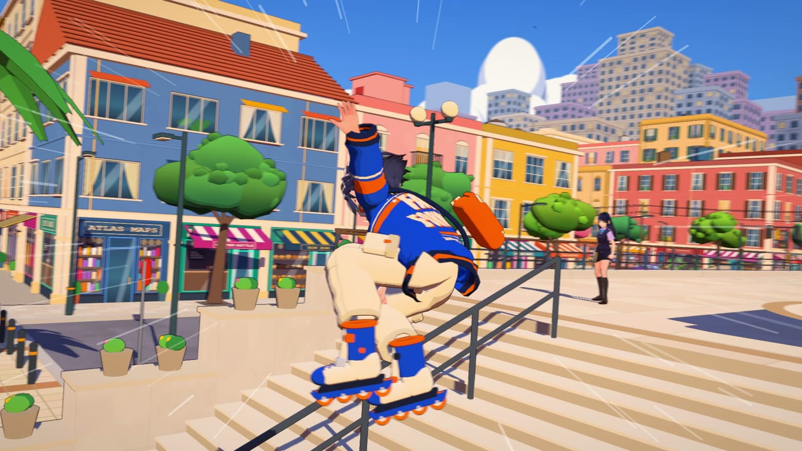
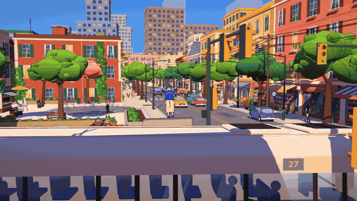
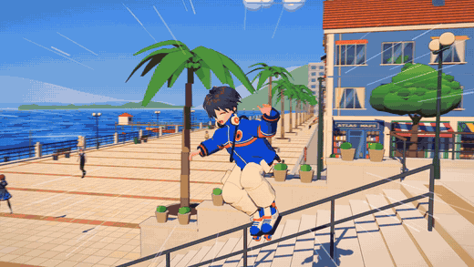
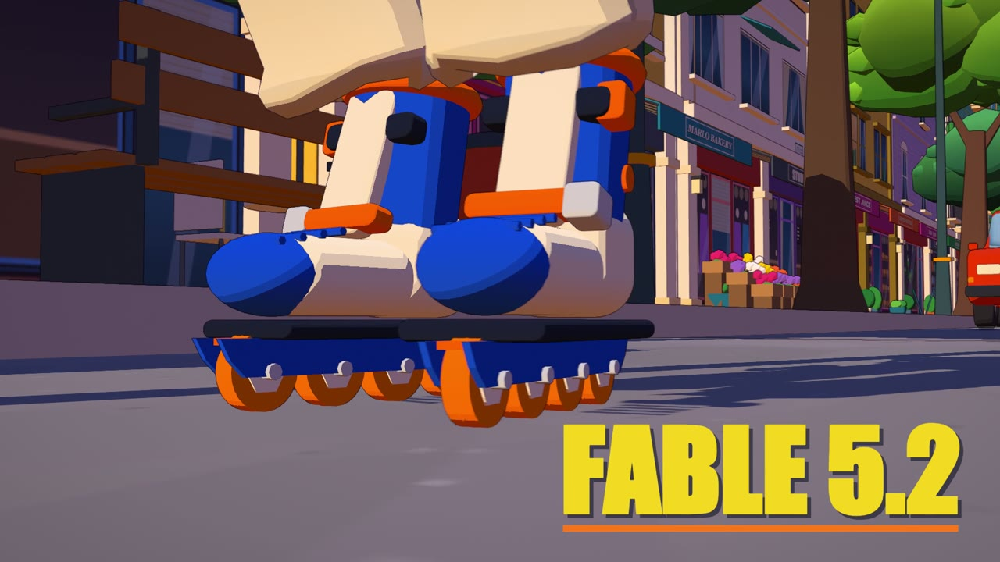
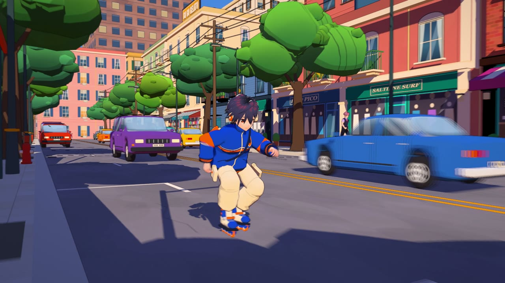
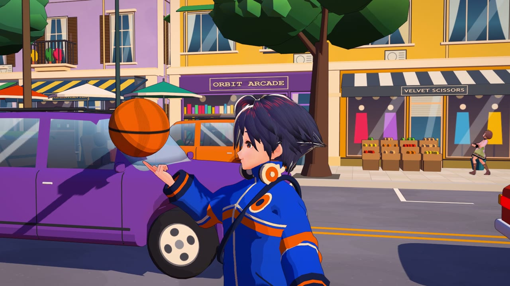
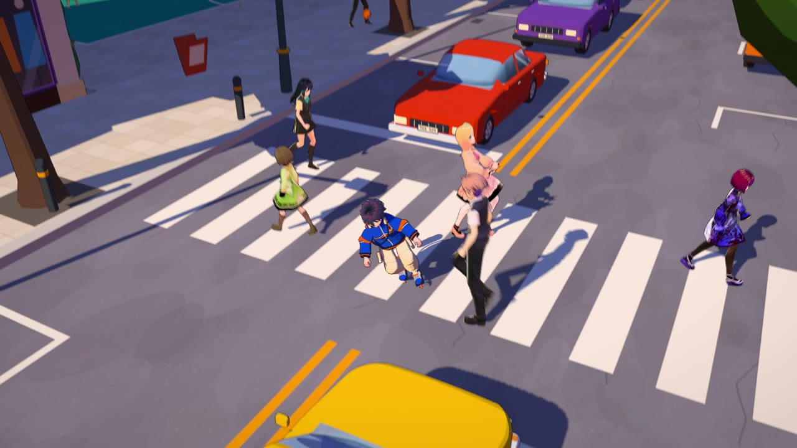
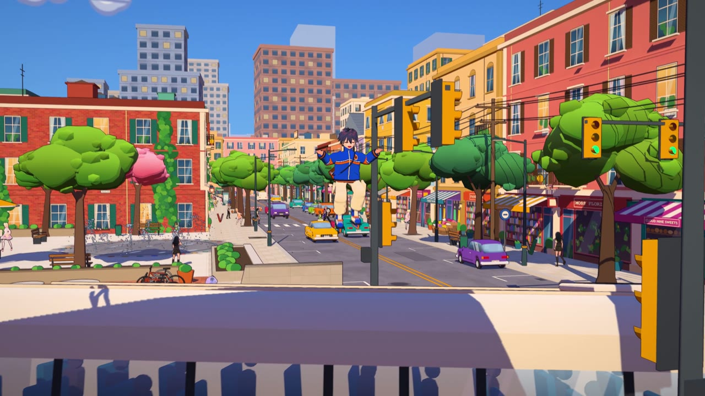
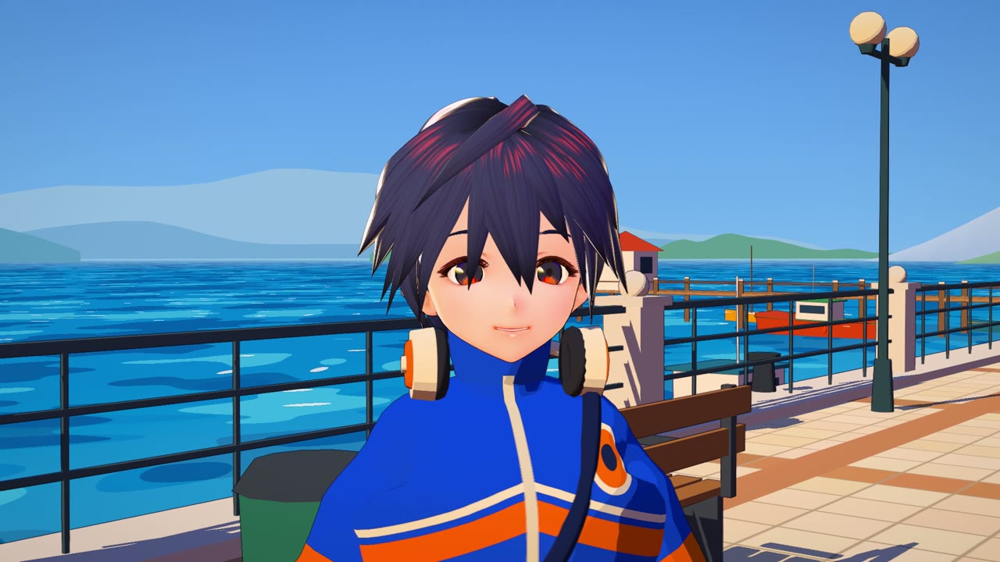

<h1 align="center">FAST FORWARD</h1>

<p align="center">
  A 90-second cel-shaded animated short, directed and built end to end by an AI coding agent<br>
  (Claude Fable 5.2) and rendered frame by frame in Three.js. No video model.
</p>

<p align="center">
  
</p>

<p align="center">
  <a href="docs/media/fast_forward_720p_silent.mp4"><b>Watch the film (720p, silent)</b></a> ·
  <a href="docs/SHOTLIST.md">Shot list</a> ·
  <a href="docs/PRODUCTION.md">Production notes</a> ·
  <a href="docs/ASSET_CREDITS.md">Asset credits</a>
</p>

| Length | Resolution | Frames | Shots | Renderer | Audio |
|---|---|---|---|---|---|
| 90 s | 1920×1080, 30 fps | 2,700 | 41 | Three.js (WebGL), offline | silent master |

## The film

A rollerblader tears through a busy, sunlit waterfront town: down the high street, over a
roadworks barrier, through a crosswalk crowd and a fountain plaza, then one impossible line —
a planter ledge, a bank ramp, the roof of a bus leaning through its turn, a raised walkway — and
a last 540 off the long stairs onto the promenade. The city keeps moving around her the whole
time. Nobody notices. She puts her headphones back on and rolls away.

The protagonist is unnamed, by design, in the film, the code and these docs.

<p align="center">
  
  
</p>

| | | |
|:---:|:---:|:---:|
| <br>Opening | <br>Down the high street | <br>Fingertip spin |
| <br>Crosswalk slalom | <br>Over the bus | <br>Ending |

<details>
<summary><b>Contact sheet — one frame from each of the 41 shots</b></summary>
<br>

</details>

## The experiment

**Question:** can a coding agent direct and deliver a complete animated short — not a tech demo —
without a video model, a DCC package or a human animator?

**Setup:** one written production brief (story beats, style target, 90 s at 1080p/30) and one
reference clip to match in craft only, followed by several rounds of plain-language review notes
from the author.

**What the agent did itself**

- Chose the pipeline: Three.js rendered offline in headless Chrome. Blender was installed and allowed; it was not needed.
- Found CC0 character and animation assets and verified each licence from the file's own metadata.
- Generated the protagonist's wardrobe, skates and accessories, the whole city, eight car types, the bus and all props in code.
- Wrote the skating animation, the choreography, the 41-shot camera plan and the cel-shaded look.
- Rendered stills and previews, judged them, and fixed what it saw.
- Took review notes (hands, hair, legs, clothing, titles, story) and fixed them in place instead of restarting.

**Result:** a coherent short with one consistent character, one continuous city, readable action
and physically solved jumps. Every frame is deterministic code output; this repository re-renders
the same film.

**Where it falls short:** it is not studio animation. Hair is rigid, cloth is approximated rather
than simulated, the crowd reuses six avatars, and several defects (wrists, elbows, clothing
clipping) were only fixed after a human pointed at specific frames. The full list is in the
[production notes](docs/PRODUCTION.md#known-limitations).

## How it works

| Stage | Approach |
|---|---|
| Characters | CC0 anime-style VRM avatars. The protagonist keeps a base avatar's head, face rig and hands; her hairstyle is refitted from another CC0 avatar. |
| Wardrobe | Jacket and cargo trousers are generated from her own body mesh so they inherit its skin weights; colours and graphics are painted per pixel. Skates, headphones and bag are modelled in code. |
| Skating | A pose vocabulary (stride, tuck, air, grab, grind, landing) solved onto the skeleton with two-bone IK, authored as one continuous performance. Jump arcs are ballistic under real gravity. |
| Hands | Explicit wrist solve (palm toward the body, forearm takes the twist) plus clearance volumes that keep hands out of the torso and thighs. |
| City | One layout file defines the geography; streets, buildings, plazas, the raised walkway, stairs, promenade and sea are procedural, with canvas-painted textures. |
| World | Traffic, the bus, pedestrians, birds, fountain water and leaves run on one clock, each timed to the moment she meets it. |
| Look | Two-tone toon shading with violet shadow fill, ink lines from depth and colour edges, sub-frame motion blur, speed lines at full sprint. |
| Rendering | Playwright steps headless Chrome through 2,700 exact timestamps on the local GPU; FFmpeg encodes H.264. |

## Tech stack

| | |
|---|---|
| Agent | Claude Fable 5.2 in Claude Code |
| Rendering | [Three.js](https://threejs.org) (WebGL) |
| Characters | VRM avatars via [`@pixiv/three-vrm`](https://github.com/pixiv/three-vrm) (CC0 VRoid samples) |
| Crowd animation | [Quaternius](https://quaternius.com) Universal Animation Library (CC0), retargeted |
| Frame capture | Playwright + headless Chrome (ANGLE/D3D11, RTX 3050) |
| Encoding | FFmpeg (libx264) |
| Tooling | TypeScript, Vite, Node |

## Run it

Requires Node 20+, Chrome or Edge, a GPU, and FFmpeg on `PATH`.

```bash
npm install
npm run dev                      # scrub the film in a browser (space = play, arrows = step)
npm run stills -- 1,19,69.4      # render single frames to output/stills/
npm run render:preview           # 960×540 preview
npm run render                   # full 1920×1080 film to output/fast_forward_final.mp4 (resumable)
npm run contact                  # contact sheet from the final film
```

Debug views (`npm run stills -- 0,1,2 --query debug=<name>`): `block` (blocking pass with a chase
camera), `skate` (pose vocabulary), `face` (expression calibration), `ground`, `buildings`,
`props`, `collide` (her path against the set's solid footprints).

## Repository layout

```
src/engine/    film runner (shots, hard cuts, sub-frame blur), post pass (ink, grade), toon look
src/char/      VRM actor (retargeting, IK, expressions), shell clothing, wardrobe, hair, skates, skating poses
src/world/     layout.ts (the one city), ground/, buildings/, vehicles/, props/
src/shots/     perform*.ts (her performance), hero/crowd/traffic/nature (the world), shots1/2.ts (41 shots), production.ts
scripts/       render.mjs (offline renderer), contact.mjs, sheet.mjs
public/assets/ third-party CC0 assets
docs/          production notes, shot list, asset credits, media
```

`output/` (rendered frames and videos) is generated locally and not committed.

## Credits and licence

- Film, code and direction: [@sn3hhaa](https://github.com/sn3hhaa), built with Claude Fable 5.2.
- Third-party assets are CC0 and listed with checksums in [docs/ASSET_CREDITS.md](docs/ASSET_CREDITS.md).
- The repository and the linked video are silent. A commercial soundtrack was added locally for
  posting; it is not part of this repository.
- No open-source licence has been chosen for the original code and film; all rights reserved by
  the author until one is.

The repository keeps the name `eidolon` from an earlier concept.
