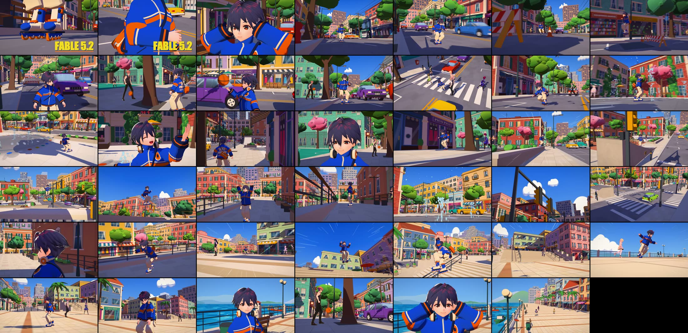

# FAST FORWARD

A 90-second cel-shaded animated short, made end to end by an AI coding agent (Claude Fable 5.2)
from one written brief and one reference clip.



**Watch:** [docs/media/fast_forward_720p_silent.mp4](docs/media/fast_forward_720p_silent.mp4)
(720p, silent copy; the 1080p master is rendered locally to `output/`).

## The film

A rollerblader tears through a busy, sunlit waterfront town: down the high street, over the
roadworks, through a crosswalk crowd and a fountain plaza, then one impossible line — planter
ledge, bank ramp, the roof of a bus leaning through its turn, a raised walkway — and a last 540
off the long stairs onto the promenade. The city keeps moving around her the whole time. Nobody
notices. She puts her headphones back on and rolls away.

The protagonist is an unnamed girl. She has no name anywhere in the film, the code or these docs.

| | |
|---|---|
| Length | 90 s · 2700 frames · 30 fps · 41 shots |
| Format | 1920×1080 · H.264 (yuv420p) |
| Silent master | `output/fast_forward_final.mp4` |
| With soundtrack | `output/fast_forward_final_with_music.mp4` (local only) |
| Soundtrack + author mark | `output/fast_forward_final_with_music_watermark.mp4` (local only) |
| Contact sheet | `output/fast_forward_contact_sheet.jpg` |

## What this experiment was

A test of one question: **can a coding agent direct and deliver a whole animated short — not a
tech demo — without a video model, a human animator or a DCC artist in the loop?**

The agent was given a production brief (story beats, style target, 90 s / 1080p / 30 fps) and a
reference clip to match in craft only. Everything else it did itself, in one working session:

- chose the pipeline (Three.js rendered offline in headless Chrome; Blender was available and not needed);
- found and licence-checked CC0 character and animation assets;
- generated the protagonist's wardrobe, the skates, the whole city, the vehicles and props in code;
- wrote the skating animation, the choreography, the 41-shot camera plan and the look;
- rendered stills, judged them, and fixed what it saw — repeatedly;
- took several rounds of plain-language review notes from the user (hands, hair, legs, titles,
  story) and fixed them in place rather than starting over.

Every frame is deterministic code output: the same repository renders the same film.

### What changed along the way

- The film began as *a girl who can move while time is frozen*. After the first preview the user
  dropped the freeze: the world now runs the whole time, and every car, walker, bird flock and the
  bus is timed to the moment she meets it.
- Review notes drove the biggest quality jumps: an explicit wrist/elbow solve and body-clearance
  for the hands, a rigid short hairstyle in place of spring-bone hair that whipped around, a
  spline stride and pose-to-pose sequences for the legs, a fingertip ball-spin replacing an
  awkward reach, a finer fountain, an animated opening title and speed lines.
- Two parallel build agents stalled on their first attempt and were re-run as three smaller jobs.

### What it shows, and where it falls short

It works as a short: one consistent character, one coherent city, readable action, physically
solved jumps. It is not studio animation. Hair is rigid, cloth is faked with a lag term rather
than simulated, the crowd is six avatars reused, and hands were only made right after a human
pointed at specific frames. The honest list is in [docs/PRODUCTION.md](docs/PRODUCTION.md).

## How it is made

- **Characters** — CC0 anime-style VRM avatars. The protagonist keeps a base avatar's head, face
  rig and hands; her hairstyle is refitted from another CC0 avatar; her oversized cobalt jacket,
  cream cargo trousers, inline skates, headphones and crossbody bag are generated in code.
- **Animation** — her skating is procedural (stride cycle, tucks, airs, grinds, landings on IK)
  as one continuous performance; jump arcs obey gravity. Pedestrians play retargeted CC0 clips.
- **City** — one procedural set (high street, plazas, raised walkway, terrace, stairs, promenade,
  sea) with traffic, a bus, pedestrians, birds, fountain water and leaves on one world clock.
- **Look** — two-tone toon shading with violet shadow fill, ink lines from depth and colour edges,
  sub-frame motion blur, speed lines at full sprint, "FABLE 5.2" animated over the opening.
- **Renderer** — Three.js in headless Chrome on the local GPU, stepped frame by frame by
  Playwright, encoded with FFmpeg.

More: [production notes](docs/PRODUCTION.md) · [shot list](docs/SHOTLIST.md) ·
[asset credits and licences](docs/ASSET_CREDITS.md).

## Run it

Requires Node 20+, Chrome or Edge, a GPU, and FFmpeg on PATH.

```
npm install
npm run dev                         # scrub the film in a browser (space = play, arrows = step)
npm run stills -- 1,19,69.4         # render single frames to output/stills/
npm run render:preview              # 960×540 preview
npm run render                      # full 1920×1080 film (resumable)
npm run contact                     # contact sheet from the final film
```

Debug views: `npm run stills -- 0,1,2 --query debug=block` (blocking pass), `debug=skate`
(pose vocabulary), `debug=face` (expressions), `debug=ground`, `debug=buildings`, `debug=props`,
`debug=collide` (her path against the set's solids).

## Layout

```
src/engine/    film runner (shots, hard cuts, sub-frame blur), post pass (ink, grade), toon look
src/char/      VRM actor (retargeting, IK, expressions), shell clothing, wardrobe, hair, skates, skating poses
src/world/     layout.ts (the one city), ground/, buildings/, vehicles/, props/
src/shots/     perform*.ts (her performance), hero/crowd/traffic/nature (the world), shots1/2.ts (41 shots), production.ts
scripts/       render.mjs (offline renderer), contact.mjs, sheet.mjs
public/assets/ third-party CC0 assets (see docs/ASSET_CREDITS.md)
```

## Soundtrack and licence

The repository and the copy linked above are silent. A soundtrack was added locally for posting;
the recording is commercial music, is not part of this repository, and is not covered by anything
here. Third-party assets are CC0 as credited. No open-source licence has been chosen for the
original code and film; all rights are reserved by the author until one is.

The repository keeps its original name, `eidolon`, from an earlier concept.
