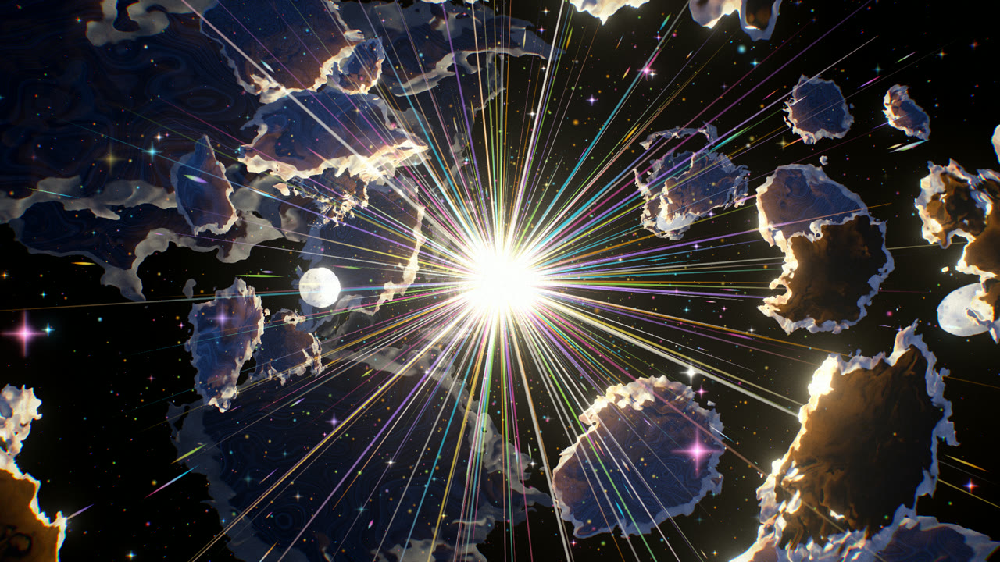
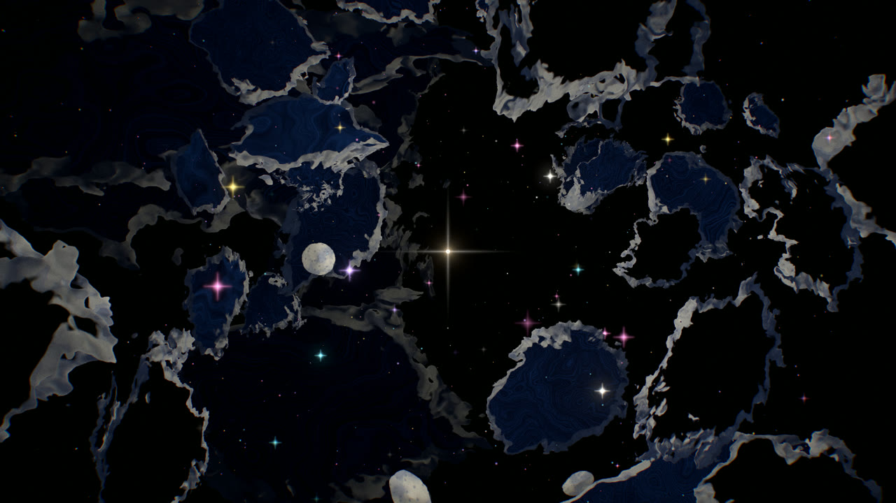
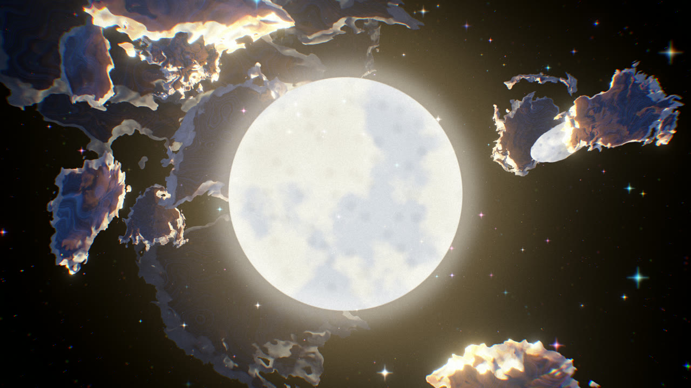

# EIDOLON

*a dream that remembers you*

A 90-second surreal animated short, built entirely in code with Three.js and
custom GLSL, and rendered offline frame by frame to video.

It is also an experiment: how far can an AI model (Claude Fable 5.2, working in
Claude Code) get as creative director, technical artist and engineer on a real
piece of animated film, judged by looking at what it renders rather than by
whether the code runs? The process is documented as it happens in
[`docs/EXPERIMENT_LOG.md`](docs/EXPERIMENT_LOG.md).

> **Status — work in progress.** The engine, the offline render pipeline and
> **Scene 01 of 9** are built. Scenes 02–09 are scheduled on the timeline but not
> made yet, and render as black. There is no finished 90-second film yet.



| | | |
|---|---|---|
|  |  |  |
| 3.2 s — the light finds the fragments | 8.6 s — the dive | 9.7 s — the core resolves into a moon |

Stills above are unretouched frames from `scripts/render.mjs`, downscaled to
1280 px. A [contact sheet](docs/media/s01_contact_sheet.jpg) shows the whole
scene at 0.4 s intervals. Rendered video is not committed; build it locally (see
*Rendering*).

## The film

No dialogue, no titles until the last one, no interface. One continuous journey
through nine environments, each handing over to the next through a shared shape.

| # | Scene | Time | Built |
|---|---|---|---|
| 01 | The Awakening — a light is born in black space and bursts | 00:00–00:10 | ✅ |
| 02 | The Forgotten Gate — a carved gateway by still water under a cobalt sky | 00:10–00:20 | — |
| 03 | The Impossible Forest — flowers the size of buildings | 00:20–00:30 | — |
| 04 | The Garden of Stars — a night garden whose light floats upward | 00:30–00:40 | — |
| 05 | The Celestial Herd — an orange eye in the sky, white antelopes, a rainbow pit | 00:40–00:50 | — |
| 06 | The Midnight Carnival — theatrical, electric, slightly wrong | 00:50–01:00 | — |
| 07 | The Floating City — retro-futurist aircraft at impossible scale | 01:00–01:10 | — |
| 08 | The Last Memory — a traveller, a fire, a giant flower; stillness | 01:10–01:20 | — |
| 09 | The Return — everything folds back into the light. Title. | 01:20–01:30 | — |

Full shot-by-shot plan: [`docs/STORYBOARD.md`](docs/STORYBOARD.md).

## Visual direction

The look is derived from seven reference artworks (kept locally, not
redistributed): black as a colour, saturated flat shapes, light that comes from
objects, things at the wrong scale, and a hand-made surface — gouache, airbrush,
crayon, pixel. No default materials, no fog, no haze.

- [`docs/ART_DIRECTION.md`](docs/ART_DIRECTION.md) — reference breakdown, palette, rules
- [`docs/ASSET_MANIFEST.md`](docs/ASSET_MANIFEST.md) — every asset, technique and status

## Technical stack

Vite · TypeScript · Three.js (WebGL 2) · custom GLSL · GSAP (easing functions) ·
three.js post-processing (EffectComposer, bloom, custom passes) · Playwright
(frame capture) · FFmpeg (H.264 encode).

Output target: 1920×1080, 30 fps, 2700 frames, exactly 90 s, MP4/H.264.

The engine is deterministic: `renderFrame(n)` depends only on `n`. Scrubbing,
previewing and exporting all call the same function. Details in
[`docs/TECHNICAL_NOTES.md`](docs/TECHNICAL_NOTES.md).

## Development setup

Requirements: Node 20+ (built with 26), a GPU with WebGL 2, and for export
FFmpeg on your PATH plus a Chromium-family browser (bundled Playwright Chromium,
or system Edge/Chrome).

```bash
git clone https://github.com/sn3hhaa/eidolon.git
cd eidolon
npm install
npm run dev          # http://localhost:5173
```

Optional, if you have no Edge/Chrome: `npx playwright install chromium`.

### Dev transport

The bar under the canvas is DOM only and never appears in rendered frames.

| Control | Key |
|---|---|
| Play / pause | `Space` |
| Step one frame (hold Shift: ten) | `←` `→` |
| Jump to scene 1–9 | `1`–`9`, or the scene menu |
| Back to start | `Home` |
| Save current frame as PNG | `S` |
| Scrub | drag the timeline |
| Loop the current scene | checkbox |
| Preview resolution | 540p / 810p / 1080p menu |

URL parameters: `?t=6.2` start time · `?scale=1` internal resolution ·
`?film=1` film mode (bare canvas, no controls — what the exporter uses).

## Rendering

```bash
npm run stills                       # a spread of PNG stills from built scenes → output/stills
node scripts/render.mjs --stills 3.2,6.2,9.95   # stills at chosen seconds
node scripts/render.mjs --scene 1 --out output/scene01.mp4   # one scene
npm run render:preview               # whole film at half resolution → output/preview.mp4
npm run render:frames                # whole film, PNG sequence only → output/frames
npm run encode                       # encode an existing sequence → output/eidolon.mp4
npm run render                       # whole film: frames + MP4 → output/eidolon.mp4
npm run smoke                        # browser test of the dev transport + determinism
```

Options: `--start/--end <sec>`, `--scale <f>`, `--crf <n>`,
`--channel chromium|msedge|chrome`, `--headed`. The script aborts if the page
reports any error, and finishes by printing ffprobe's codec, size, frame rate,
frame count and duration for the encoded file.

Everything under `output/` is git-ignored.

## Repository layout

```
src/engine/     timeline, tracks, camera rig, post pipeline
src/scenes/     one folder per scene
src/dev/        development transport
src/film.ts     the master timeline
scripts/        offline renderer
docs/           art direction, storyboard, manifest, tech notes, experiment log
```

## Asset credits

Everything on screen is procedural and generated by this code. Reference images
are third-party works with unverified authorship and are not included. Full
detail and dependency licences: [`docs/ASSET_CREDITS.md`](docs/ASSET_CREDITS.md).

## Experiment goals

1. Find out whether an AI model can hold a *visual identity* across a
   multi-scene film instead of producing a generic Three.js demo.
2. Make the model responsible for looking: every scene is rendered, inspected and
   revised against the references before it is called done.
3. Keep an honest record — including what failed, what was not tested, and
   where the result falls short of the reference.

## Lessons so far

- Code that compiles and renders proves nothing about the picture. The first
  three versions of Scene 01 all "worked"; one was pure black, one a lens flare.
- Bloom destroys a black-background look faster than anything else.
- One `pow()` of a negative number is a NaN, and one NaN through a blur is a
  black frame.
- Pacing problems are invisible in stills; contact sheets expose them.
- On-screen size goes as 1/distance, so an ease-in on distance feels like
  nothing, then everything.

More, with the frames that prompted them, in the
[experiment log](docs/EXPERIMENT_LOG.md).

## Licence

No licence has been chosen yet.
